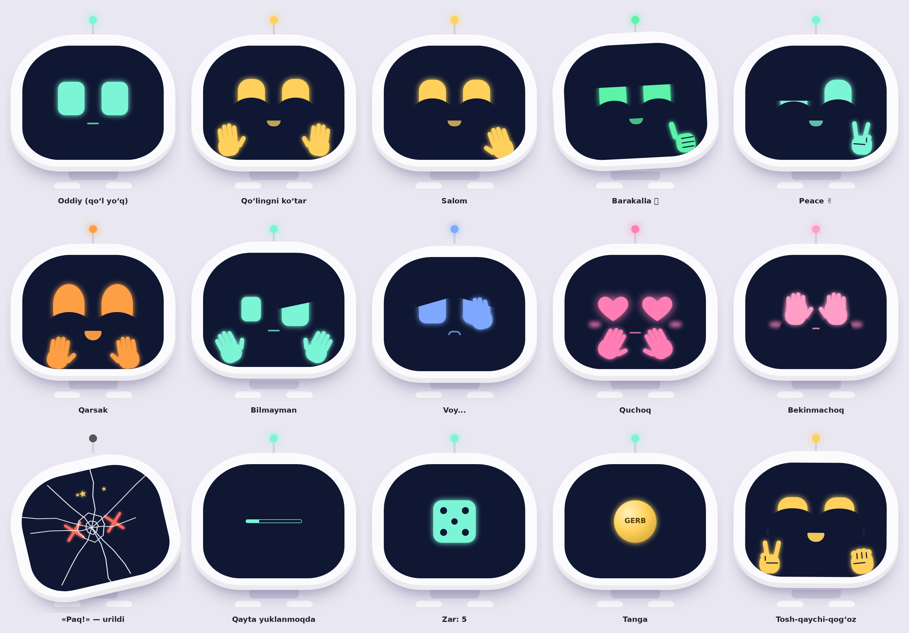

# Bit — hamkasb robot (v1)




Bit oʻzbek, rus va ingliz tillarida gaplashadigan, emotsiyali agent. U sizning nomingizdan Telegramga yozadi (faqat siz tasdiqlaganingizdan keyin), YouTubeʼda qoʻshiq qoʻyadi, kompyuterda ilova va papkalarni ochadi, taymer qoʻyadi va ishingiz haqidagi faktlarni eslab qoladi.

```
Telefon / PC (PWA: Bit yuzi, mikrofon, ovoz)
        │ HTTPS + token
        ▼
backend (FastAPI, Docker)  ── Claude API (tool use)
  ├─ xotira + audit log (SQLite, data/bit.db)
  ├─ Telegram (Telethon, oq roʻyxat, tasdiqlash)
  └─ YouTube qidiruv (yt-dlp)
        │ client action
        ▼
local-agent (faqat shu kompyuter, 127.0.0.1:8765) → ilova / papka ochish
```

## Papkalar

| Papka | Nima |
|---|---|
| `backend/` | Server: `app/agent.py` (agent), `app/tools/` (qobiliyatlar), `tests/` |
| `frontend/` | Ilova (PWA): `index.html`, `manifest.webmanifest`, `sw.js` |
| `local-agent/` | Kompyuterda ilova va papka ochuvchi kichik dastur |
| `data/` | Baza va `contacts.json` (Gitʼga tushmaydi) |

## 1. Desktopga joylash

**Windows (PowerShell):**
```powershell
Expand-Archive "$HOME\Downloads\bit-agent.zip" -DestinationPath "$HOME\Desktop" -Force
cd "$HOME\Desktop\bit-agent"
copy .env.example .env
copy data\contacts.example.json data\contacts.json
notepad .env
```

**Linux:**
```bash
unzip ~/Downloads/bit-agent.zip -d ~/Desktop && cd ~/Desktop/bit-agent
cp .env.example .env && cp data/contacts.example.json data/contacts.json
nano .env
```

## 2. Kalitlar (.env)

1. `ANTHROPIC_API_KEY`: console.anthropic.com → API Keys. Bu claude.ai obunasidan alohida va pullik.
2. `BIT_API_TOKEN`: ilova paroli. Yaratish: `python -c "import secrets;print(secrets.token_urlsafe(32))"`
3. Telegram (ixtiyoriy): my.telegram.org → *API development tools* → `TELEGRAM_API_ID`, `TELEGRAM_API_HASH`.

### Bepul "miya" (Claude oʻrniga)

`.env` da `BIT_LLM_PROVIDER=openai` qilib, quyidagilardan birini tanlang:

| Variant | Narx | Sifat | Sozlash |
|---|---|---|---|
| **Google Gemini** | Bepul tier (daqiqasiga bir necha soʻrov) | Yaxshi, oʻzbekchani biladi | aistudio.google.com → *Get API key* → `OPENAI_API_KEY` |
| **Groq** | Bepul tier | Oʻrtacha, juda tez | console.groq.com → kalit, `OPENAI_BASE_URL` va modelni almashtiring |
| **Ollama** | Butunlay bepul, internetsiz | Kuchsizroq, 8 GB+ RAM | `ollama pull qwen2.5:7b`, `OPENAI_BASE_URL=http://localhost:11434/v1` |

Bepul tierlarda yuborilgan matnlar provayder tomonidan modelni yaxshilash uchun ishlatilishi mumkin — maxfiy maʼlumot yubormang. Model nomlari vaqt oʻtishi bilan oʻzgaradi: amaldagi nomni provayder saytidan tekshiring.

## 3. Ishga tushirish

Docker Desktop (Windows) yoki Docker (Linux) kerak.
```bash
docker compose up -d --build
docker compose logs -f bit
```
Brauzerda **http://localhost:8000** ni oching va ⚙ sozlamalarga `BIT_API_TOKEN`ni kiriting.

Linuxda `data` papkasiga yozish xatosi chiqsa: `sudo chown -R 1000 data`.

Dockersiz tez sinash:
```bash
cd backend && python -m venv .venv && . .venv/bin/activate   # Windows: .venv\Scripts\activate
pip install -r requirements.txt
set -a; . ../.env; set +a; export BIT_DATA_DIR=../data        # Windows: qiymatlarni $env:... bilan bering
uvicorn app.main:app --port 8000
```

## 4. Telegram ulash

```bash
docker compose run --rm bit python scripts/telegram_login.py
```
Telefon raqamingiz, Telegramʼdan kelgan kod va 2FA parolni kiritasiz. Chiqqan `TELEGRAM_SESSION=...` qatorini `.env`ga qoʻying va `docker compose up -d` ni qayta ishga tushiring.

`data/contacts.json` bu **oq roʻyxat**. Bit faqat shu yerdagi odamlarga yoza oladi:
```json
{ "ali": "@ali_username", "onam": "+998901234567" }
```
Telefon raqam faqat u Telegram kontaktlaringizda saqlangan boʻlsa ishlaydi, `@username` ishonchliroq.

> ⚠️ `TELEGRAM_SESSION` akkauntingizga toʻliq kirish beradi. Uni hech kimga bermang va Gitʼga qoʻymang. Ommaviy xabar yuborilsa, Telegram akkauntni bloklashi mumkin. Shuning uchun soatlik limit bor (`TELEGRAM_MAX_PER_HOUR`).

## 5. Kompyuter agenti (ilova va papka ochish)

```bash
cd local-agent
python bit_local_agent.py        # Windows: start_windows.bat ni ikki marta bosing
```
Oynada chiqqan **token**ni ilova sozlamalaridagi "Kompyuter agenti tokeni" maydoniga kiriting.
Ochiladigan ilovalar roʻyxati `local_agent_config.json` faylining `apps` boʻlimida. Desktopdagi papkalarni nomi bilan ochadi, masalan: *"Desktopdagi BitProject papkasini och"*.

## 6. Telefonda ishlatish

Mikrofon va "ilova sifatida oʻrnatish" uchun **HTTPS** shart. Ikki variant bor:

- **VPS + domen:** DNSʼda domenni VPS IPʼsiga yoʻnaltiring, `.env`da `DOMAIN=` ni yozing va `docker compose --profile https up -d` ni ishga tushiring. Caddy sertifikatni oʻzi oladi.
- **Uy kompyuteri:** Tailscale (`tailscale serve 8000`) yoki Cloudflare Tunnel. Port ochish shart emas.

Telefonda saytni oching, keyin brauzer menyusidan **"Bosh ekranga qoʻshish" / "Install app"** ni tanlang.
Telefonda `open_on_computer` ishlamaydi, bu normal holat. Telegram, YouTube va taymer ishlaydi.

## 7. Misol buyruqlar

- "Aliga ertaga dars soat 9 da deb yoz" → tasdiqlash kartasi chiqadi → **Ha, bajar**
- "YouTubeʼda Sherali Joʻrayev Bevafo qoʻshigʻini qoʻy"
- "Desktopdagi BitProject papkasini och", "VS Codeʼni och"
- "Eslab qol: CTF darsi har seshanba soat 14:00"
- "25 daqiqaga taymer qoʻy"

## 8. Tugʻilgan kunlar va bayramlar

- "Mening tugʻilgan kunim 15-may" yoki "Alining tugʻilgan kuni 3-noyabr" deng — Bit eslab qoladi (`save_event`).
- Shu kuni ilovani ochganingizda Bit tabriklaydi: yuzida salyut yoki konfetti, boshida bayram qalpogʻi, qarsak chaladi. Doʻstingizning tugʻilgan kunida Telegramʼda tabrik yuborishni taklif qiladi (tasdiq bilan).
- Doimiy bayramlar: `backend/app/holidays_uz.json` (tahrirlash mumkin). Hayitlar har yili oʻzgaradi — toʻliq sana bilan ayting: "2027-03-10 Ramazon hayiti".
- Roʻyxat: "Yaqin bayramlar qaysi?" yoki `GET /api/events`.

### Koʻrish: kamera va ekran rasmi, yuzidagi YouTube

- 📷 tugmasi: kamera ochiladi → "Rasmga olish" → savol bering ("bu nima?", "bu kodda xato bormi?") yoki shunchaki yuboring. ⟲ — old/orqa kamera.
- 🖥 tugmasi: ekraningiz (yoki bitta oyna) rasmga olinadi va Bitga koʻrsatiladi. Telefonlarda brauzer buni qoʻllamaydi.
- Rasmlar serverda saqlanmaydi, faqat oʻsha savol bilan modelga yuboriladi. Bepul Gemini tierida Google ularni koʻrishi mumkin — maxfiy narsani koʻrsatmang.
- YouTube endi Bitning yuzida (ekranida) oʻynaydi; "Katta ekran" va "Yuzdan olish" tugmalari bor.

### Dizayn va kichik oʻyinchoqlar

Dubulgʻa-bosh, yaltiroq qora vizor, neon halqali “quloqlar”, nur sharli antenna, neon chiziqli oyoqlar va **B** logotip. Yuz — neon chiziqli ifodalar (⚙ → *Yuz uslubi* → *Klassik bloklar* eski koʻzlarni qaytaradi).

- **Quloqni bosing** — halqa aylanadi va ohang chaladi
- **Antennani bosing** — “boing!” qilib tebranadi
- **B logotipni bosing** — 5 soniyalik disko: neonlar kamalakdek rang almashadi, Bit raqsga tushadi
- Gapirayotganda quloq halqalari, hayajonlanganda oyoq chiroqlari “nafas oladi”
- Tayyor rang toʻplamlari: "binafsha boʻl", "yashil kiyin", "sariq", "muz", "pushti", "tun", "klassik"

### Rangini oʻzgartirish

"Koʻzingni koʻk qil", "Korpusingni qora qil", "Rangingni asl holiga qaytar" — yoki ⚙ → *Koʻz va korpus rangi*. Rang serverda saqlanadi va hamma qurilmada bir xil boʻladi. Jahldor (qizil) va sevgi (pushti yurak) holatlari oʻz rangida qoladi.

### Yordamchi birinchi oʻrinda

Ochilganda Bit "Bugun nimada yordam beray?" deydi va tezkor tugmalarni koʻrsatadi: 📐 matematika, 📖 mavzu tushuntirish, 🎬 video, 🎨 rasm, 🌤 ob-havo, ⏰ eslatma. Oʻyinlar faqat siz soʻrasangiz.

- **Doska:** "Kasrlarni qoʻshishni tushuntir", "Kvadrat tenglamani misol bilan koʻrsat", "Shu masalani yech: ..." — oq doska chiqadi, Bit har qadamni **yozib**, shu paytning oʻzida **ovoz bilan tushuntiradi** (formulalar KaTeX bilan chiroyli chiqadi). Doskadagi yozuvni ham oʻqiydi ("toʻrtdan uch qoʻshuv…"), har ikki qadamdan keyin "Shu yergacha tushunarlimi?" deb soʻraydi: "ha" — davom etadi, "tushunmadim" — oʻsha qadamni boshqa misol bilan qayta tushuntiradi. Pauza / Keyingi / Qaytadan tugmalari, oxirida javob va oʻzingiz yechadigan mashq.
- **Rasm chizish:** "Choy ichayotgan mushuk-robot rasmini chiz" — Gemini rasm modeli (bepul tier ruxsat bersa) yoki Pollinations (bepul, kalitsiz). Rasmni yuklab olish mumkin. Soʻrov matni oʻsha xizmatlarga yuboriladi.
- **Video:** "YouTubeʼdan fotosintez haqida video och" — Bitning yuzida oʻynaydi.

### Ustoz rejimi

"Bolalarga kuchli parolni tushuntir", "Fotosintez nima?", "SQL injection qanday ishlaydi, sodda qilib oʻrgat" — Bit bitiruv qalpogʻi va koʻzoynak taqadi, ekranda **dars taxtasi** chiqadi: bosqichma-bosqich tushuntirish, misol (kod yoki hayotiy holat) va tekshiruv savoli. "Javob beraman" — javobingizni yozasiz yoki aytasiz, Bit baholaydi va keyingi qadamni taklif qiladi. "Oʻqib ber" — taxtadagini ovoz bilan oʻqiydi.

### Qoʻllar va oʻyinlar

Qoʻllar Bitning **ekranida** (koʻzlari kabi yonib) paydo boʻladi: "qoʻlingni koʻtar", "qarsak chal", "salom ber", "barmogʻingni koʻrsat" va h.k. Oʻyinlar (tasodif serverda tanlanadi, Bit aldamaydi):

| Ayting | Nima boʻladi |
|---|---|
| "Paq!", "Seni otdim!" | Oʻq uchib kelib ekranga tegadi, ekran yoriladi, koʻzlari ✕✕, boshi atrofida yulduzchalar, keyin "qayta yuklanib" qaytadi va sizga barmoq bilan "paq" qiladi |
| "Tosh-qaychi-qogʻoz oʻynaymiz" | Bit soʻraydi, keyin ikkala qoʻl silkinib, tanlovlar ekranda chiqadi |
| "Zar tashla", "Tanga tashla" | Ekranda zar aylanadi / tanga aylanib tushadi |
| "Bekinmachoq" | Koʻzlarini qoʻllari bilan yopib, "kukuu!" qilib chiqadi |

### Kundalik yordamchi

| Imkoniyat | Qanday | Izoh |
|---|---|---|
| «Hey Bit» | ☑ «Hey Bit» bilan chaqirish → "Hey Bit, ob-havo qanday?" | Faqat Google Chrome. Yoqilganda ovoz doimiy Google nutq xizmatiga yuboriladi — kerak boʻlmaganda oʻchiring |
| Aniq vaqtga eslatma | "Ertaga soat 8 da darsni eslat" | Ilovada chiqadi + (Telegram ulangan boʻlsa) "Saved Messages"ga keladi |
| Ob-havo | "Ertaga Samarqandda havo qanday?" | Open-Meteo, bepul, kalitsiz. Standart shahar: `BIT_HOME_CITY` |
| Viktorina | "Bolalar uchun Linux boʻyicha 5 ta savol ber" | Bit bitta-bitta soʻraydi, ball yuqorida koʻrinadi, oxirida bayram |
| Pomodoro | "Pomodoro boshla" yoki "50/10 pomodoro" | Diqqat vaqtida Bit jim va jiddiy, tanaffusda raqs tushadi |
| Meni kuzat | ☑ 👀 Meni kuzat | Kamera kichik oʻlchamda, kadrlar **faqat qurilmada** qayta ishlanadi, hech qayerga yuborilmaydi. Burchakdagi qizil nuqta = kamera yoniq |

### Aqlli uy (Home Assistant)

Bit uydagi qurilmalarni [Home Assistant](https://www.home-assistant.io/) orqali boshqaradi: konditsioner, chiroqlar, rozetkalar, televizor, aqlli muzlatgich va h.k. — HA qoʻllaydigan har qanday qurilma.

1. Home Assistant oʻrnating (Raspberry Pi, mini-PC yoki Docker: `docker run -d --name ha --network host -v ~/ha:/config ghcr.io/home-assistant/home-assistant:stable`) va qurilmalaringizni unga ulang.
2. HA → Profil → **Security** → **Long-lived access tokens** → token yarating.
3. `.env`: `HA_URL=http://<ha-ip>:8123`, `HA_TOKEN=...`; qurilma nomlari: `cp data/devices.example.json data/devices.json` va tahrirlang.
4. "Konditsionerni oʻchir", "Muzlatgichni 3 gradusga tushir", "Zaldagi chiroqni yoq", "Qaysi qurilmalar bor?"

Qulflar, signalizatsiya va garaj/eshiklar har doim **tasdiq** bilan bajariladi.

## 9. Kompyuter ilovasi (Windows, macOS, Linux)

`desktop/` — Bit ekran burchagida kichik robot boʻlib turadi (hamma oynalar ustida). Ustiga bosing — panel ochiladi.

| Qanday | Nima qiladi |
|---|---|
| Robotni sudrab olib boring | xohlagan joyga koʻchadi, joyini eslab qoladi |
| **Ctrl+Shift+Space** | kursor turgan joyni rasmga olib, oʻsha soʻz/matnni tushuntiradi (kitob, PDF, sayt, terminal…). Linuxda belgilangan matnni ham oʻqiydi |
| 🎯 Kursor ostidagini tushuntir | 3 soniya ichida kursorni soʻz ustiga olib borasiz |
| 🖥 Ekranni tushuntir | butun ekran rasmini koʻrsatadi |
| 📋 Nusxalangan matn | Ctrl+C qilingan matnni tushuntiradi |
| Tray belgisi | koʻrsatish, kichraytirish, server manzili, kompyuter yonganda ochilish, chiqish |

**Oʻrnatish fayllarini olish:** GitHub → **Actions** → *Desktop app* → **Run workflow**. Tayyor boʻlgach, artefaktlardan yuklab oling: Windows `.exe`, macOS `.dmg`, Linux `.AppImage` / `.deb`. `v1.0.0` kabi teg qoʻysangiz, avtomatik **Release** ham yaratiladi.

Oʻzingiz yigʻish: `cd desktop && npm install && npm run dist` (har bir OS oʻz oʻrnatuvchisini yigʻadi).

Birinchi ishga tushirishda server manzili soʻraladi (standart `http://127.0.0.1:8001`), keyin ⚙ da tokenni kiriting.

> Ilovalar imzolanmagan: Windows "SmartScreen" ogohlantirsa — *Batafsil → Baribir ishga tushirish*; macOS'da — ilovani oʻng tugma → *Open*, va *Settings → Privacy → Screen Recording* da Bitga ruxsat bering.

### Telefonda: "Ulashish → Bit"

Bitni telefonga ilova qilib oʻrnating (brauzer → *Bosh ekranga qoʻshish*). Keyin istalgan ilovada (kitob, brauzer, Telegram) soʻzni belgilab → **Ulashish → Bit** — Bit oʻsha soʻzni tushuntiradi (Android Chrome). Telefonda boshqa ilovalar ustida suzib yuruvchi robot uchun alohida Android ilova kerak — keyingi bosqich.

## 10. Yangi qobiliyat qoʻshish

`backend/app/tools/` ichiga yangi fayl qoʻshing, server uni oʻzi topadi:
```python
from .base import Tool, ToolError

class Weather(Tool):
    name = "get_weather"
    description = "Get current weather for a city. Returns {temp_c, text}."
    input_schema = {"type": "object", "properties": {"city": {"type": "string"}}, "required": ["city"]}
    side_effect = False   # hech narsani oʻzgartirmaydi -> tasdiqsiz bajariladi
    risky = False         # True boʻlsa, har doim tasdiq soʻraladi

    async def run(self, args, ctx):
        ...
        return {"temp_c": 12, "text": "bulutli"}
```

## 11. Xavfsizlik

- Har bir amal `audit` jadvaliga yoziladi. Koʻrish: `GET /api/audit` (token bilan).
- Mustaqillik darajasi `BIT_AUTONOMY` bilan sozlanadi: 0 — hamma amal tasdiq bilan, 1 — faqat xavfli amallar tasdiq bilan (standart), 2 — tasdiqsiz.
- Tasdiq kutayotgan amal 10 daqiqadan keyin eskiradi va faqat bir marta bajariladi.
- Backend porti faqat `127.0.0.1`da ochiq. Tashqaridan kirish faqat HTTPS orqali.
- Kompyuter agenti faqat `127.0.0.1`da, token bilan ishlaydi va faqat roʻyxatdagi ilova va papkalarni ochadi. Unga ixtiyoriy yoʻl yoki buyruq berib boʻlmaydi.

## 12. Testlar

```bash
cd backend && pip install -r requirements.txt && python -m pytest -q
# yoki: docker compose run --rm bit python -m pytest -q
```
Testlar soxta Claude javoblari yordamida butun agent zanjirini tekshiradi: tool chaqiruvi, tasdiqlash, oq roʻyxat, xavfli URL va buyruqlarni rad etish, token.

## Muammolar

| Belgi | Yechim |
|---|---|
| "Token notoʻgʻri" | Sozlamalardagi token `.env`dagi `BIT_API_TOKEN` bilan bir xilligini tekshiring |
| `ANTHROPIC_API_KEY is not set` | `.env`ni toʻldirib, `docker compose up -d` ni qayta ishga tushiring |
| Telegram: "not authorized" | `telegram_login.py`ni qayta ishga tushiring |
| YouTube qidiruv ishlamadi | `docker compose build --no-cache` (yt-dlp yangilanadi). Bu holatda ham Bit qidiruv sahifasini ochib beradi |
| Kompyuter agenti javob bermaydi | `bit_local_agent.py` ishlayotganini, token toʻgʻriligini va brauzer Chrome ekanini tekshiring |
| Bit gapirmayapti | `.env` da `BIT_TTS=edge` boʻlsin (server Microsoft neyron ovozlari bilan gapiradi, internet kerak). Brave brauzer ovozlarini bloklaydi, shuning uchun server ovozi tavsiya etiladi |
| Mikrofon ishlamaydi | Brave va Chromium nutqni tanimaydi — Google Chromeʼda oching |
| Oʻzbekcha ovoz yoʻq | Windows: Sozlamalar → Vaqt va til → Nutq. Oʻzbekcha ovoz boʻlmasa, turkcha ovoz ishlatiladi yoki javob matnda chiqadi |
