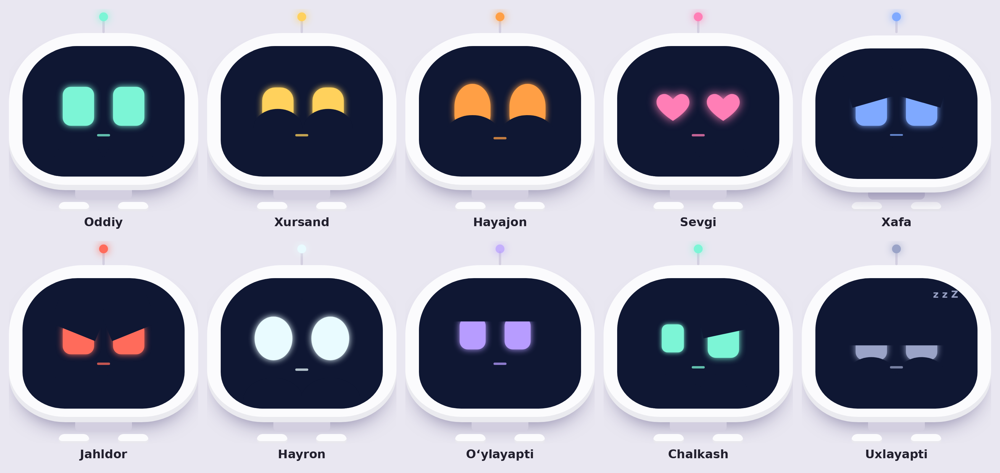

# Bit — hamkasb robot (v1)



Bit oʻzbek, rus va ingliz tillarida gaplashadigan, emotsiyali agent. U sizning nomingizdan Telegramga yozadi (faqat siz tasdiqlaganingizdan keyin), YouTubeʼda qoʻshiq qoʻyadi, kompyuterda ilova va papkalarni ochadi, taymer qoʻyadi va ishingiz haqidagi faktlarni eslab qoladi.

```
Telefon / PC (PWA: Bit yuzi, mikrofon, ovoz)
        │ HTTPS + token
        ▼
backend (FastAPI, Docker)  ── Claude API (tool use)
  ├─ xotira + audit log (SQLite, data/bit.db)
  ├─ Telegram (Telethon, oq roʻyxat, tasdiqlash)
  └─ YouTube qidiruv (yt-dlp)
        │ client action
        ▼
local-agent (faqat shu kompyuter, 127.0.0.1:8765) → ilova / papka ochish
```

## Papkalar

| Papka | Nima |
|---|---|
| `backend/` | Server: `app/agent.py` (agent), `app/tools/` (qobiliyatlar), `tests/` |
| `frontend/` | Ilova (PWA): `index.html`, `manifest.webmanifest`, `sw.js` |
| `local-agent/` | Kompyuterda ilova va papka ochuvchi kichik dastur |
| `data/` | Baza va `contacts.json` (Gitʼga tushmaydi) |

## 1. Desktopga joylash

**Windows (PowerShell):**
```powershell
Expand-Archive "$HOME\Downloads\bit-agent.zip" -DestinationPath "$HOME\Desktop" -Force
cd "$HOME\Desktop\bit-agent"
copy .env.example .env
copy data\contacts.example.json data\contacts.json
notepad .env
```

**Linux:**
```bash
unzip ~/Downloads/bit-agent.zip -d ~/Desktop && cd ~/Desktop/bit-agent
cp .env.example .env && cp data/contacts.example.json data/contacts.json
nano .env
```

## 2. Kalitlar (.env)

1. `ANTHROPIC_API_KEY`: console.anthropic.com → API Keys. Bu claude.ai obunasidan alohida va pullik.
2. `BIT_API_TOKEN`: ilova paroli. Yaratish: `python -c "import secrets;print(secrets.token_urlsafe(32))"`
3. Telegram (ixtiyoriy): my.telegram.org → *API development tools* → `TELEGRAM_API_ID`, `TELEGRAM_API_HASH`.

### Bepul "miya" (Claude oʻrniga)

`.env` da `BIT_LLM_PROVIDER=openai` qilib, quyidagilardan birini tanlang:

| Variant | Narx | Sifat | Sozlash |
|---|---|---|---|
| **Google Gemini** | Bepul tier (daqiqasiga bir necha soʻrov) | Yaxshi, oʻzbekchani biladi | aistudio.google.com → *Get API key* → `OPENAI_API_KEY` |
| **Groq** | Bepul tier | Oʻrtacha, juda tez | console.groq.com → kalit, `OPENAI_BASE_URL` va modelni almashtiring |
| **Ollama** | Butunlay bepul, internetsiz | Kuchsizroq, 8 GB+ RAM | `ollama pull qwen2.5:7b`, `OPENAI_BASE_URL=http://localhost:11434/v1` |

Bepul tierlarda yuborilgan matnlar provayder tomonidan modelni yaxshilash uchun ishlatilishi mumkin — maxfiy maʼlumot yubormang. Model nomlari vaqt oʻtishi bilan oʻzgaradi: amaldagi nomni provayder saytidan tekshiring.

## 3. Ishga tushirish

Docker Desktop (Windows) yoki Docker (Linux) kerak.
```bash
docker compose up -d --build
docker compose logs -f bit
```
Brauzerda **http://localhost:8000** ni oching va ⚙ sozlamalarga `BIT_API_TOKEN`ni kiriting.

Linuxda `data` papkasiga yozish xatosi chiqsa: `sudo chown -R 1000 data`.

Dockersiz tez sinash:
```bash
cd backend && python -m venv .venv && . .venv/bin/activate   # Windows: .venv\Scripts\activate
pip install -r requirements.txt
set -a; . ../.env; set +a; export BIT_DATA_DIR=../data        # Windows: qiymatlarni $env:... bilan bering
uvicorn app.main:app --port 8000
```

## 4. Telegram ulash

```bash
docker compose run --rm bit python scripts/telegram_login.py
```
Telefon raqamingiz, Telegramʼdan kelgan kod va 2FA parolni kiritasiz. Chiqqan `TELEGRAM_SESSION=...` qatorini `.env`ga qoʻying va `docker compose up -d` ni qayta ishga tushiring.

`data/contacts.json` bu **oq roʻyxat**. Bit faqat shu yerdagi odamlarga yoza oladi:
```json
{ "ali": "@ali_username", "onam": "+998901234567" }
```
Telefon raqam faqat u Telegram kontaktlaringizda saqlangan boʻlsa ishlaydi, `@username` ishonchliroq.

> ⚠️ `TELEGRAM_SESSION` akkauntingizga toʻliq kirish beradi. Uni hech kimga bermang va Gitʼga qoʻymang. Ommaviy xabar yuborilsa, Telegram akkauntni bloklashi mumkin. Shuning uchun soatlik limit bor (`TELEGRAM_MAX_PER_HOUR`).

## 5. Kompyuter agenti (ilova va papka ochish)

```bash
cd local-agent
python bit_local_agent.py        # Windows: start_windows.bat ni ikki marta bosing
```
Oynada chiqqan **token**ni ilova sozlamalaridagi "Kompyuter agenti tokeni" maydoniga kiriting.
Ochiladigan ilovalar roʻyxati `local_agent_config.json` faylining `apps` boʻlimida. Desktopdagi papkalarni nomi bilan ochadi, masalan: *"Desktopdagi BitProject papkasini och"*.

## 6. Telefonda ishlatish

Mikrofon va "ilova sifatida oʻrnatish" uchun **HTTPS** shart. Ikki variant bor:

- **VPS + domen:** DNSʼda domenni VPS IPʼsiga yoʻnaltiring, `.env`da `DOMAIN=` ni yozing va `docker compose --profile https up -d` ni ishga tushiring. Caddy sertifikatni oʻzi oladi.
- **Uy kompyuteri:** Tailscale (`tailscale serve 8000`) yoki Cloudflare Tunnel. Port ochish shart emas.

Telefonda saytni oching, keyin brauzer menyusidan **"Bosh ekranga qoʻshish" / "Install app"** ni tanlang.
Telefonda `open_on_computer` ishlamaydi, bu normal holat. Telegram, YouTube va taymer ishlaydi.

## 7. Misol buyruqlar

- "Aliga ertaga dars soat 9 da deb yoz" → tasdiqlash kartasi chiqadi → **Ha, bajar**
- "YouTubeʼda Sherali Joʻrayev Bevafo qoʻshigʻini qoʻy"
- "Desktopdagi BitProject papkasini och", "VS Codeʼni och"
- "Eslab qol: CTF darsi har seshanba soat 14:00"
- "25 daqiqaga taymer qoʻy"

## 8. Yangi qobiliyat qoʻshish

`backend/app/tools/` ichiga yangi fayl qoʻshing, server uni oʻzi topadi:
```python
from .base import Tool, ToolError

class Weather(Tool):
    name = "get_weather"
    description = "Get current weather for a city. Returns {temp_c, text}."
    input_schema = {"type": "object", "properties": {"city": {"type": "string"}}, "required": ["city"]}
    side_effect = False   # hech narsani oʻzgartirmaydi -> tasdiqsiz bajariladi
    risky = False         # True boʻlsa, har doim tasdiq soʻraladi

    async def run(self, args, ctx):
        ...
        return {"temp_c": 12, "text": "bulutli"}
```

## 9. Xavfsizlik

- Har bir amal `audit` jadvaliga yoziladi. Koʻrish: `GET /api/audit` (token bilan).
- Mustaqillik darajasi `BIT_AUTONOMY` bilan sozlanadi: 0 — hamma amal tasdiq bilan, 1 — faqat xavfli amallar tasdiq bilan (standart), 2 — tasdiqsiz.
- Tasdiq kutayotgan amal 10 daqiqadan keyin eskiradi va faqat bir marta bajariladi.
- Backend porti faqat `127.0.0.1`da ochiq. Tashqaridan kirish faqat HTTPS orqali.
- Kompyuter agenti faqat `127.0.0.1`da, token bilan ishlaydi va faqat roʻyxatdagi ilova va papkalarni ochadi. Unga ixtiyoriy yoʻl yoki buyruq berib boʻlmaydi.

## 10. Testlar

```bash
cd backend && pip install -r requirements.txt && python -m pytest -q
# yoki: docker compose run --rm bit python -m pytest -q
```
Testlar soxta Claude javoblari yordamida butun agent zanjirini tekshiradi: tool chaqiruvi, tasdiqlash, oq roʻyxat, xavfli URL va buyruqlarni rad etish, token.

## Muammolar

| Belgi | Yechim |
|---|---|
| "Token notoʻgʻri" | Sozlamalardagi token `.env`dagi `BIT_API_TOKEN` bilan bir xilligini tekshiring |
| `ANTHROPIC_API_KEY is not set` | `.env`ni toʻldirib, `docker compose up -d` ni qayta ishga tushiring |
| Telegram: "not authorized" | `telegram_login.py`ni qayta ishga tushiring |
| YouTube qidiruv ishlamadi | `docker compose build --no-cache` (yt-dlp yangilanadi). Bu holatda ham Bit qidiruv sahifasini ochib beradi |
| Kompyuter agenti javob bermaydi | `bit_local_agent.py` ishlayotganini, token toʻgʻriligini va brauzer Chrome ekanini tekshiring |
| Oʻzbekcha ovoz yoʻq | Windows: Sozlamalar → Vaqt va til → Nutq. Oʻzbekcha ovoz boʻlmasa, turkcha ovoz ishlatiladi yoki javob matnda chiqadi |
